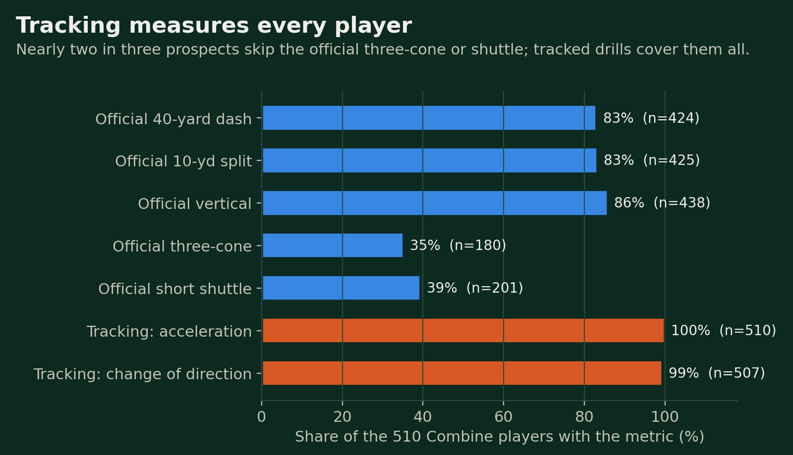
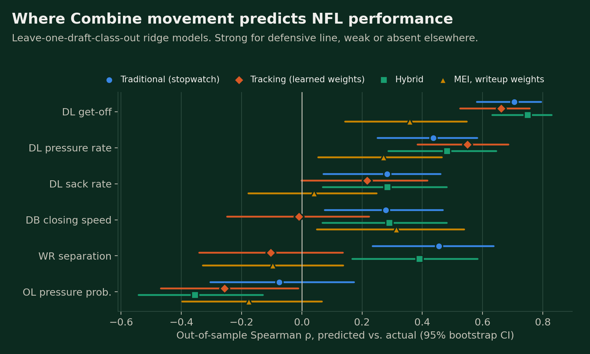
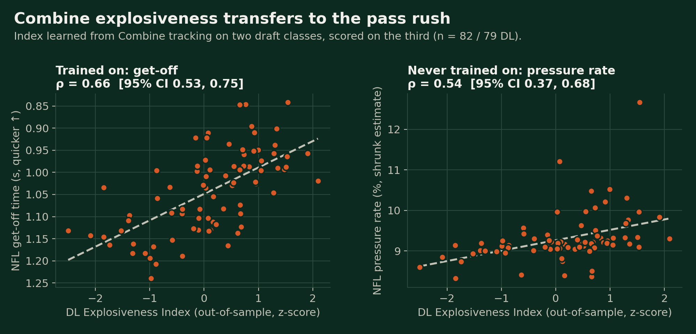
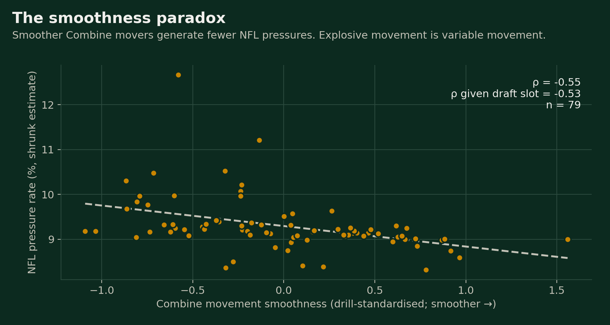
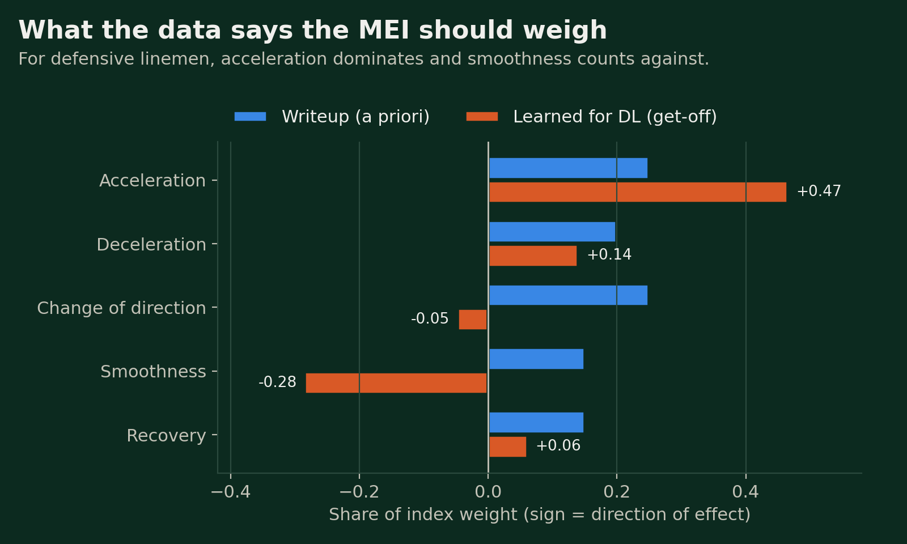

# Explosiveness Transfers, Smoothness Misleads

### Rebuilding the Movement Efficiency Index (MEI) with Combine sensor tracking

> **Competition theme:** *"Uncover non-obvious linkages between Combine sensor tracking and regular-season NFL game performance."*

## Executive Summary

We turned 463,000 frames of 10 Hz Combine tracking into a **Movement Efficiency Index (MEI)** with five parts: acceleration, deceleration, change of direction, smoothness and recovery. We then tested it against three seasons of NFL regular-season performance for 510 prospects. Every model was scored only on draft classes it never saw.

**Key findings**

1. **Explosiveness transfers, for defensive linemen.** A DL Explosiveness Index built only from Combine tracking predicts NFL get-off (ρ = 0.66). It also predicts **pass-rush pressure rate, an outcome it was never trained on** (ρ = 0.54, 95% CI 0.37–0.68). That relationship holds with draft slot held fixed (ρ = 0.50).
2. **The smoothness paradox.** Smoother Combine movers generate *fewer* NFL pressures (ρ = −0.53 given draft slot). Explosive movement is variable movement, and a metric that rewards smoothness penalises the best pass rushers.
3. **Tracking measures everyone.** Only 35% of prospects ran an official three-cone and 39% a shuttle. Tracked position drills give agility and acceleration measures for 100%.
4. **Honest negatives.** Combine movement did not predict WR/TE separation, OL pass protection, or availability beyond what the stopwatch and draft slot already capture. Three of our four original hypotheses were refuted.

```
 ┌──────────────────┐    ┌──────────────────┐    ┌──────────────────┐    ┌──────────────────┐
 │  COMBINE SENSOR  │    │  MOVEMENT EVENTS │    │       MEI        │    │  NFL REGULAR     │
 │  TRACKING        │───►│  sprints · stops │───►│  5 components,   │───►│  SEASON OUTCOMES │
 │  463k frames     │    │  9,462 cuts      │    │  position-scaled │    │  2023–2025       │
 │  510 players     │    │  6,264 attempts  │    │                  │    │                  │
 └──────────────────┘    └──────────────────┘    └──────────────────┘    └──────────────────┘
                                                          │                       │
                                                          └──────────┬────────────┘
                                                                     ▼
                                                  leave-one-draft-class-out models
```

---

## 1. The Question

Traditional Combine metrics measure **outcomes**: one number from a stopwatch. Tracking measures **processes**: how a player accelerates, stops, turns and recovers, ten times a second. We asked:

> **Which movement characteristics observed at the Combine predict NFL performance, and do they add anything the stopwatch and the draft board don't already know?**

## 2. Data

| Source | Content |
|---|---|
| Combine tracking | 10 Hz x/y/speed for 510 players (2023–2025 classes): 40, shuttle, three-cone and 50+ position drills |
| Combine results | Official times, jumps, measurables |
| Players / career | Draft slot (383 drafted), snaps, starts, games active |
| Player-play | 249k regular-season player-plays: separation, pressure, get-off, coverage |
| Game tracking | In-game 10 Hz tracking for the same players (8,800 DB man-coverage throws) |

| Position | WR | TE | DB | DL | OL |
|---|---|---|---|---|---|
| Combine players | 107 | 42 | 122 | 118 | 121 |

Only regular-season plays are used. Preseason and playoff plays are excluded.

## 3. Measuring Movement: the MEI

Each drill attempt is trimmed to active movement and smoothed with a Savitzky-Golay filter. Every **cut** is detected by comparing the direction of travel in the 0.8 s before and after each frame. That approach catches both rounded breaks and plant-and-reverse moves where speed passes through zero.

| Component | Definition |
|---|---|
| Acceleration Efficiency | 0.9 × peak speed ÷ time to reach it |
| Deceleration Control | Speed lost ÷ distance used, in the hardest deceleration |
| Change-of-Direction Efficiency | Heading change ÷ time lost vs. holding approach speed |
| Movement Smoothness | −log RMS of acceleration around its trend (unnecessary variation) |
| Recovery Acceleration | Speed regained ÷ time after the slowest point of a cut |

```
 Acceleration Efficiency               Change of Direction            Recovery
 speed                                                                speed
   ▲     ╭────────── A (explosive)     ───────►╮                        ▲ ───╮          ╭──
   │   ╭─╯    ╭───── B                         │ heading change         │     ╲       ╱
   │  ╱   ╭───╯                                │ ÷ time lost            │      ╲    ╱ ← slope
   │ ╱╭───╯                                    ▼                        │       ╰──╯
   └┴──────────► time                                                   └────────────► time
```

Components are scored within each drill (rank-based z-scores), averaged per player, and standardised within position group.

**Validation against the stopwatch** (Spearman ρ):

| Check | ρ |
|---|---|
| Tracked 40 top speed vs. official 40 time | −0.97 |
| 40 Acceleration Efficiency vs. official 10-yard split | −0.65 |
| Three-cone Acceleration Efficiency vs. official three-cone | −0.74 |
| Shuttle COD Efficiency vs. official shuttle | −0.51 |

The three-cone is excluded from change-of-direction scoring. Its 5-yard legs mix reversals and rounded weaves, and per-cut efficiency there ran opposite to the official time.



## 4. NFL Outcomes and Reliability

An outcome can only be predicted if it is a stable player trait. We measured split-half reliability (odd vs. even games, Spearman-Brown) and kept outcomes at about 0.6 or higher. Rates and means are shrunk toward the position mean with empirical Bayes.

| Position | Outcome | Reliability |
|---|---|---|
| DL | Get-off time (in-game first step) | 0.93 |
| DL | Pressure rate | 0.75 |
| DL | Sack rate | 0.56 (secondary) |
| OL | Peak pressure probability allowed | 0.80 |
| WR / TE | Separation at pass forward | 0.75 |
| WR / TE | Yards per route run | 0.62 |
| DB | Closing speed after the throw, man coverage | 0.76 |
| All | Snaps per season, share of games active | career totals |

Dropped as noise: OL sacks allowed (≈ 0), WR/TE EPA per route (0.36), TE pass blocking (median 10 snaps).

## 5. Modelling Strategy

```
 ┌─────────────────────┐  ┌─────────────────────┐  ┌─────────────────────┐  ┌─────────────────────┐
 │ M1 TRADITIONAL      │  │ M2 TRACKING         │  │ M2b MEI (FIXED)     │  │ M3 HYBRID           │
 │ 40 · 10-yd · jumps  │  │ 5 MEI components,   │  │ original weights    │  │ M1 + M2             │
 │ height · weight     │  │ learned weights     │  │ .25/.20/.25/.15/.15 │  │                     │
 └──────────┬──────────┘  └──────────┬──────────┘  └──────────┬──────────┘  └──────────┬──────────┘
            └────────────────────────┴───────────┬────────────┴────────────────────────┘
                                                 ▼   each also run "+ draft slot"
                     ┌──────────────────────────────────────────────────────────────┐
                     │ Ridge regression · leave-one-draft-class-out CV              │
                     │ OOS ρ and R² · 1,000–2,000 bootstrap CIs · 200 permutations  │
                     └──────────────────────────────────────────────────────────────┘
```

Training on two Combine classes and predicting the third mimics the real draft problem: scoring a class nobody has seen play. 294 single-feature tests were corrected with Benjamini-Hochberg, and 31 survive at q < 0.10.

## 6. Results

### 6.1 Explosiveness transfers to the pass rush



For defensive linemen, Combine tracking alone predicts NFL get-off as well as the stopwatch does (ρ 0.66 vs. 0.71). The hybrid model is best (ρ 0.75, R² 0.52). With draft slot held fixed, tracking adds **+0.41 R²** for get-off and **+0.16 R²** for pressure rate (95% CI 0.02–0.43).

The strongest test is **transfer**. We trained a DL Explosiveness Index on get-off only, then scored unseen draft classes on pass-rush production:



| Outcome (unseen class) | ρ | 95% CI | ρ given draft slot |
|---|---|---|---|
| Get-off (trained) | 0.66 | 0.53–0.75 | 0.64 |
| **Pressure rate (never trained)** | **0.54** | **0.37–0.68** | **0.50** |
| Sack rate (never trained) | 0.31 | 0.10–0.51 | 0.29 |
| Snaps per season | 0.21 | 0.04–0.38 | 0.07 |

The index predicts *production*, not *playing time*. Once draft slot is known, it barely predicts snaps (ρ 0.07), yet it still predicts pressure (ρ 0.50). That gap is the non-obvious linkage: **teams play the linemen they drafted early, but Combine explosiveness tells you which ones will actually get home.**

### 6.2 The smoothness paradox



We expected smooth movement to signal neuromuscular control. For defensive linemen, the opposite holds. Smoother Combine movers get off the ball slower (ρ = +0.58 given draft slot) and generate fewer pressures (ρ = −0.53, q < 0.001). The most explosive athletes show the most acceleration variation, because they change speed hard and often. Within position, smoothness also correlates with slower 40 times (ρ = +0.26).

### 6.3 Rewriting the MEI



Our original fixed weights predicted DL get-off at only ρ 0.36, about half of what learned weights achieve out of sample (0.66). For DL, the data says acceleration should carry about half the weight, deceleration a little, and change of direction almost none, while smoothness should count against. **MEI v2 is therefore position-specific and learned, then validated on unseen classes.** The original weights remain the baseline it beats.

### 6.4 Where tracking does not help

| Position | Result |
|---|---|
| **WR** | Separation is predicted by traditional metrics (ρ 0.46), not tracking (ρ −0.10). Deceleration has no link to separation (ρ −0.10 given draft slot) |
| **TE** | No signal; only 22–23 tight ends had enough routes |
| **OL** | Nothing predicts pass protection: tracking, stopwatch and draft slot alike |
| **DB** | Closing speed is predicted by traditional metrics (ρ 0.28) and the fixed-weight MEI (ρ 0.31), not by learned weights |
| **Playing time** | Draft slot explains snaps and availability (ρ 0.50–0.83); Combine metrics add nothing |

## 7. Hypothesis Scorecard

| Original hypothesis | Verdict | Evidence |
|---|---|---|
| Tracking metrics predict NFL performance | ✅ **For DL** | Get-off, pressure, sacks (permutation p ≤ 0.01) |
| Hybrid beats traditional alone | ❌ | No significant ΔR² anywhere (DL get-off +0.04, CI −0.01 to 0.10) |
| Acceleration > top speed | ❌ | DL get-off: acceleration ρ −0.62, top speed −0.66 |
| Deceleration predicts WR separation | ❌ | ρ −0.10 given draft slot |
| Movement symmetry predicts availability | ❌ | All positions \|ρ\| ≤ 0.14, p ≥ 0.13 |
| Position drills carry hidden value | ◐ | They cover every player and carry the stopwatch's DL signal |

## 8. Football Operations Impact

| Area | Application |
|---|---|
| **Draft evaluation** | Use the DL Explosiveness Index to rank pass rushers within a draft tier. It predicts pressure beyond draft slot |
| **Missing workouts** | About one in five DL in our sample had no official 40. Tracked drills give their explosiveness anyway |
| **Scouting language** | Do not reward "smooth" DL movement. For pass rushers, violent speed changes are the signal |
| **Where not to look** | Combine movement is not a WR separation or OL protection tool; spend evaluation time elsewhere |

## 9. Limitations

- Three Combine classes give small samples (TE n ≈ 22; DB tracking n = 66), so null results are not proof of no effect.
- Outcomes cover at most three seasons, and 2025 rookies have one.
- Players who never played enough snaps have no outcome (survivorship).
- Get-off and closing speed are themselves movement measures. The pressure-rate transfer is the stronger evidence of on-field value.

## 10. Conclusion

Combine tracking does not tell us everything, but where it speaks it speaks clearly. For defensive linemen, how explosively a prospect moves in Combine drills predicts how quickly they get off the ball and how often they pressure the quarterback. It does so in draft classes the model never saw, and beyond what draft position already implies. The best movers are not the smoothest: **explosiveness transfers, smoothness misleads.** The original Movement Efficiency Index gave us the right components, and the data showed us how to weigh them.

---

### Appendix: Reproducibility

Every number and figure in this writeup is rebuilt from the raw competition data by the public notebook **[Explosiveness Transfers, Smoothness Misleads](https://www.kaggle.com/code/simphiwetwala/explosiveness-transfers-smoothness-misleads)** (about 20 minutes on a Kaggle CPU session). It includes unit tests for the movement metrics, the 200-permutation model run, the transfer test and the figures.
